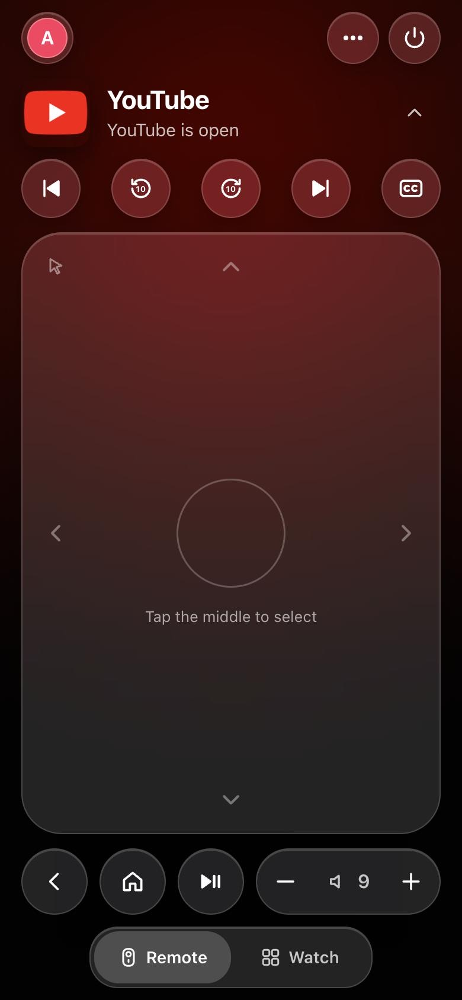

# couch-tv on an LG webOS monitor, with the bridge on a Raspberry Pi

This fork follows [Seagey/couch-tv](https://github.com/Seagey/couch-tv) and records one working
setup: couch-tv on an **LG 43SQ700S-WB** (a 2022 MyView smart monitor, 4K, webOS 22) with the
bridge running in **Docker on a Raspberry Pi 5**. Everything here uses upstream's code. The general
LG guide is [docs/LG.md](docs/LG.md); this page adds what was learned on this particular setup.



*The phone remote, served by the bridge on the Pi, while YouTube is open on the LG: the app's own
colours, skip and 10-second buttons, the touchpad, Back, Home, play/pause and volume.*

## The setup

| | |
|---|---|
| TV | LG 43SQ700S-WB monitor, webOS 22 (network remote reports 7.0.0), firmware 03.07.00 |
| couch-tv on the TV | The LG app (`lg/build.py`), installed in Developer Mode |
| Bridge | Raspberry Pi 5 (8 GB), Debian 13, in Docker with host networking |
| Phone remote | The bridge's web page, added to the phone's home screen |

## What it took

- **Developer Mode stays alive by itself.** LG's `@webos-tools/cli` is installed in the bridge's
  Docker image, so the bridge presses Developer Mode's Extend once a day with `ares-launch`. The
  bridge also reads how many hours are left (987 at the last check) and warns before it runs out.
- **Build the phone remote once.** The bridge only serves the remote after it has been built.
  Without it, the bridge's address shows "Remote: Not built yet" and nothing else on the phone works:

  ```sh
  cd remote
  npm ci
  npm run build
  ```

  Build it on any computer with Node 20 or newer and copy `remote/dist/` to the bridge.
- **Run the bridge in Docker with host networking**, so it can reach the TV's network remote,
  send Wake-on-LAN and serve the phone. Upstream now has a ready example in
  [docs/DOCKER.md](docs/DOCKER.md) and [examples/docker](examples/docker).
- **App icons.** LG gives the icons of apps without a bundled logo (Stremio, JioHotstar, ZEE5,
  SonyLIV, Amazon Alexa, LG Gaming Portal) on its self-signed secure port, so the home showed
  letters. `lg/build.py` now fetches them from the TV itself.
- **A weak chip with a 4K panel.** The home was slow with the 4K photos, and froze when Home
  settings opened because of the full-screen blur behind it. What this TV runs:
  - the Classic look, with glass panels and moving tiles off;
  - every blur and the large soft shadows taken out. This TV used a local patch for that;
    upstream's `"lighter": true` in `home` takes out the same blur and shadows, but has not been
    tried on this TV yet;
  - `"hi_res": false` in `home`, which keeps the 1080 photos and makes the LG app about 17 MB
    smaller (22 MB down to under 6 MB). It is proposed upstream in
    [Seagey/couch-tv#77](https://github.com/Seagey/couch-tv/pull/77) and is not in this fork's
    code until that is merged.

  With those, each press on the home shows on screen in about 6 to 47 ms.

## Staying up to date

This fork's `main` is kept level with upstream using GitHub's **Sync fork**. Watch the upstream
repository for **Releases** (Watch, Custom, Releases) to hear about each new version, then sync.

Thanks to Seagey and everyone who reported their TVs upstream. couch-tv is MIT licensed; see
[LICENSE](LICENSE).
